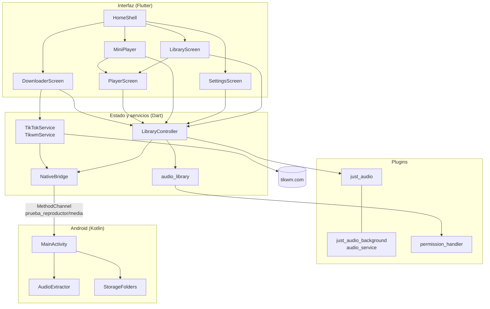
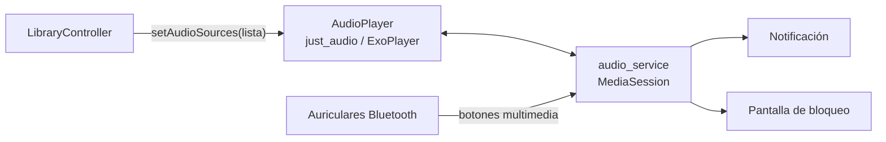
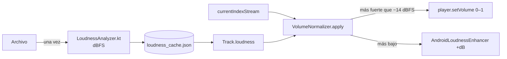
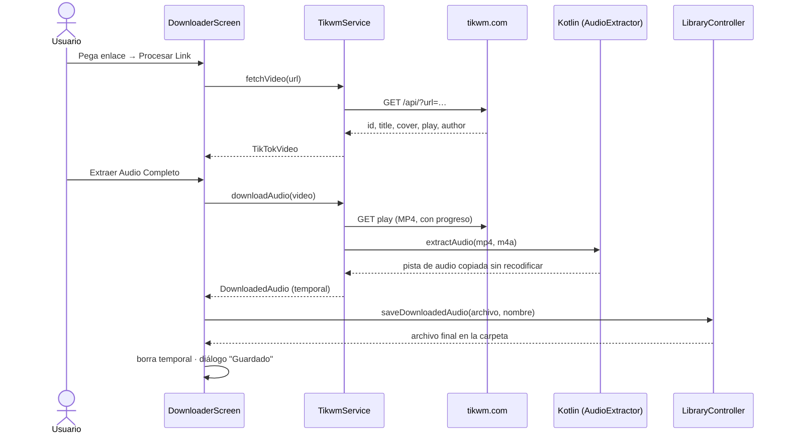

# Arquitectura

Este documento describe cómo está organizada la app, cómo fluyen los datos y por qué. Las decisiones importantes tienen su justificación completa en los [ADR](adr/README.md).

## Visión general



| Capa | Responsabilidad | No debe |
|---|---|---|
| **Interfaz** | Mostrar estado y traducir gestos en llamadas | Acceder a archivos, red o canal nativo directamente |
| **LibraryController** | Única fuente de verdad: carpeta, canciones, reproductor y guardado de archivos | Saber de TikTok |
| **TikTokService** | Resolver enlaces, descargar y extraer audio a un archivo temporal | Saber dónde se guarda el resultado |
| **NativeBridge** | Exponer el código Kotlin con una API Dart tipada | Contener lógica de negocio |
| **Kotlin** | Lo que Flutter no puede hacer: SAF, extracción de audio y metadatos | Mantener estado propio, salvo el selector pendiente |

## Gestión de estado

La app no usa paquetes de gestión de estado. `LibraryController` es un `ChangeNotifier` creado en `main()` y pasado por constructor:

- `HomeShell` lo escucha con un `ListenableBuilder` y reconstruye las pestañas cuando cambia.
- El estado de reproducción (posición, canción actual, play/pausa) **no** se duplica en el controlador. Los widgets se suscriben directamente a los *streams* de `AudioPlayer` con `StreamBuilder`.
- El estado efímero de cada pantalla (texto del enlace, progreso de la descarga) vive en su `State`.

Con la escala actual (3 pestañas, un controlador), esto evita dependencias y mantiene el flujo explícito. Si la app crece, la migración natural es `provider` o `riverpod` sin cambiar `LibraryController`.

## Reproducción



- Cada canción es un `AudioSource.file` con un `MediaItem` como `tag` (título y álbum = nombre de la carpeta). Ese `MediaItem` es lo que muestran la notificación y los dispositivos Bluetooth.
- La lista se carga con `preload: false`: no se decodifica nada hasta que el usuario toca una canción. Mientras el reproductor está `idle`, el mini reproductor permanece oculto.
- Una descarga nueva se agrega con `insertAudioSource(0, …)`, sin interrumpir lo que está sonando.
- `MainActivity` hereda de `AudioServiceActivity`. Eso hace que el motor de Flutter lo cree y lo guarde en caché `audio_service`, para que la música siga sonando sin la actividad (ver [ADR-0001](adr/0001-reproduccion-con-just-audio-background.md)).
- **Invariante:** `tracks[i]` de `LibraryController` corresponde siempre a `player.audioSources[i]`. Agregar, eliminar o renombrar actualiza las dos listas en la misma posición. Renombrar la canción que suena reemplaza su `AudioSource` y retoma desde el mismo punto (puede notarse un corte breve).

### Retomar la reproducción

`LibraryController` guarda un `PlaybackState` (ruta de la canción, posición, modo aleatorio y modo de repetición) en el ajuste nativo `playback_state`:
- cada 5 segundos mientras suena, al pausar, al cambiar de canción o de modo, y al pasar la app a segundo plano (`AppLifecycleListener` en `HomeShell`);
- nunca mientras se carga una carpeta, porque en ese momento el índice actual y la lista no coinciden.

Al arrancar, `restore()` lee el estado **antes** de abrir la carpeta (abrirla cambia la canción actual y lo sobrescribiría). Luego lo pasa como `initialIndex`/`initialPosition` a `setAudioSources` con `preload: true`, así la canción queda cargada en pausa y el mini reproductor aparece listo. Se guarda la **ruta** y no el índice, porque el orden cambia al descargar, renombrar o eliminar audios.

### Nivelación de volumen



`AudioPlayer` se crea con un `AudioPipeline` que incluye el `AndroidLoudnessEnhancer`. Fórmulas, límites y justificación en la [guía de nivelación](guides/nivelacion-de-volumen.md) y en el [ADR-0007](adr/0007-nivelacion-de-volumen.md).

### Gestión de la biblioteca

| Acción | Cómo se activa | Implementación |
|---|---|---|
| Buscar | Campo en el encabezado | Filtro en `LibraryScreen` sin distinguir mayúsculas ni tildes (`foldForSearch`). La lista filtrada conserva el índice real de cada canción para reproducirla |
| Renombrar | Mantener pulsada → Renombrar | `LibraryController.renameTrack`: SAF (`renameInFolder`) si hay URI; si no, `File.rename` |
| Eliminar | Mantener pulsada → Eliminar (con confirmación) | `deleteTrack`: SAF (`deleteFromFolder`) o `File.delete`, y luego `removeAudioSourceAt` |
| Compartir | Mantener pulsada → Compartir | `shareTrack` → `FileProvider` + `ACTION_SEND` (lo inverso de [recibir contenido](guides/recibir-contenido-compartido.md)) |

Las acciones viven en `track_actions.dart` (menú inferior y diálogos). Renombrar y eliminar usan el permiso SAF, así que funcionan también con archivos creados por otras apps dentro de la carpeta.

## Almacenamiento

### Modelo de carpeta

Una carpeta se identifica con **dos valores**, persistidos con las `SharedPreferences` nativas (archivo `app_settings`):

| Clave | Ejemplo | Uso |
|---|---|---|
| `music_folder` | `/storage/emulated/0/TikTok Gym` | **Leer:** buscar y reproducir archivos con `dart:io` |
| `music_folder_uri` | `content://com.android.externalstorage.documents/tree/primary%3ATikTok%20Gym` | **Escribir:** crear archivos mediante el SAF |

¿Por qué dos? Desde Android 11, una app con permiso de lectura de audio puede **leer** con rutas normales casi cualquier carpeta. En cambio, solo puede **crear** archivos en ciertas carpetas estándar (`Music`, `Download`…). Para escribir en una carpeta propia de la raíz hace falta el permiso que se concede al elegirla en el selector del sistema ([ADR-0003](adr/0003-escritura-con-storage-access-framework.md)).

La carpeta predeterminada `Music/TikTok` (botón **Restaurar**) no tiene URI: ahí Android permite escribir directamente.

### Escritura de un archivo descargado

```mermaid
flowchart TD
    A[saveDownloadedAudio] --> B{¿hay URI SAF?}
    B -- Sí --> C[NativeBridge.saveToFolder<br/>DocumentsContract.createDocument]
    C --> D[Nombre final devuelto por Android<br/>p. ej. 'audio (1).m4a']
    B -- No --> E[File.copy a la ruta<br/>nombre único 'audio (2).m4a']
    D & E --> F[NativeBridge.scanFile<br/>visible para otras apps]
    F --> G[insertAudioSource en la posición 0]
```

## Descarga desde TikTok



- **Extracción:** `MediaExtractor` lee la pista AAC del MP4 y `MediaMuxer` la escribe en un contenedor MP4 solo de audio (`.m4a`). No hay recodificación ([ADR-0004](adr/0004-extraccion-de-audio-nativa.md)).
- **Respaldo:** si la pista no se puede copiar tal cual, se guarda el MP4 completo con extensión `.m4a`. Se reproduce igual, solo que es más pesado.
- **Nombre del archivo:** `cleanFileName(title)` quita hashtags, menciones, emojis y caracteres inválidos, recorta a 60 caracteres y elimina puntos finales. Si queda vacío, se usa `tiktok_<id>`.
- **Duplicados:** `DownloadHistory` guarda `id del video → ruta del archivo` en `downloads.json` y se actualiza al renombrar o eliminar. Al procesar un enlace, `LibraryController.findDownloaded` busca por id y, para descargas anteriores al historial, por nombre de archivo. Solo avisa: el usuario puede descargar otra vez.
- **Desde el menú Compartir:** `MainActivity` (con `launchMode="singleTask"`) recibe el `ACTION_SEND`. `HomeShell` extrae el enlace con `extractTikTokUrl`, abre la pestaña Descargar y se lo pasa por un `ValueNotifier`. La pantalla lo procesa como si el usuario lo hubiera pegado. Detalle en la [guía de contenido compartido](guides/recibir-contenido-compartido.md) y en el [ADR-0006](adr/0006-recibir-enlaces-compartidos.md).
- **Intercambiable:** la pantalla solo conoce la interfaz `TikTokService`. Cambiar de proveedor implica escribir otra implementación y cambiar una línea en `home_shell.dart`.

## Permisos

| Permiso | Versión de Android | Para qué |
|---|---|---|
| `READ_MEDIA_AUDIO` | 13+ | Leer audios de la carpeta |
| `READ_EXTERNAL_STORAGE` | ≤ 12 | Ídem en versiones anteriores |
| `WRITE_EXTERNAL_STORAGE` | ≤ 9 | Escribir en `Music/TikTok` |
| `INTERNET` | todas | API y descarga |
| `WAKE_LOCK`, `FOREGROUND_SERVICE`, `FOREGROUND_SERVICE_MEDIA_PLAYBACK` | todas / 14+ | Reproducción en segundo plano |
| `POST_NOTIFICATIONS` | 13+ | Evitar que algunos fabricantes oculten la notificación |
| Permiso de carpeta SAF | todas | Escritura en la carpeta elegida (persistente) |

## Interfaz

| Elemento | Archivo | Notas |
|---|---|---|
| Tema y paleta | `theme.dart` | `AppColors` replica el diseño original: morado `#1C0F45`, rosa `#FF4081` y verde `#00C853` |
| Pestañas | `home_shell.dart` | `IndexedStack`: cada pestaña conserva su estado al cambiar |
| Diálogos | `theme.dart` → `showAppAlert` | Estilo de alerta nativa de Android |
| Reproductor | `player_screen.dart` | Disco que gira y late mientras suena (`AnimationController`) |
