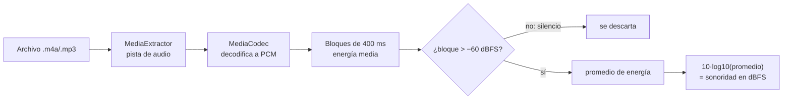

# Guía: nivelación de volumen entre audios

> **Problema:** los audios de TikTok tienen volúmenes muy distintos. Con auriculares, uno apenas se oye y el siguiente suena demasiado fuerte.
>
> **Solución en este proyecto:** medir una vez cuán fuerte suena cada archivo y, al cambiar de canción, compensar la diferencia para que todos suenen parecido.
>
> **Archivos:** `LoudnessAnalyzer.kt` (medición), `lib/volume_normalizer.dart` (caché y compensación) y `LibraryController` (cuándo aplicarla).

## 1. Conceptos

### 1.1 Decibelios (dB)
El oído percibe el volumen de forma **logarítmica**: duplicar la potencia no suena "el doble de fuerte". Por eso se mide en decibelios, una escala logarítmica:

| Cambio | Factor de amplitud | Cómo se percibe |
|---|---|---|
| +6 dB | ×2 | Notablemente más fuerte |
| +3 dB | ×1,41 | Un poco más fuerte |
| 0 dB | ×1 | Igual |
| −6 dB | ×0,5 | Notablemente más bajo |
| −20 dB | ×0,1 | Mucho más bajo |

Fórmulas usadas en el código:

```
factor de amplitud = 10^(dB / 20)          → para setVolume
dB                 = 10 · log10(energía)   → para medir (energía = amplitud²)
```

### 1.2 dBFS
En audio digital, **0 dBFS** (*decibels relative to Full Scale*) es el valor máximo que puede representar una muestra. Todo lo demás es negativo: un audio típico de TikTok ronda entre −20 y −10 dBFS de sonoridad promedio.

### 1.3 Sonoridad no es lo mismo que pico
Un audio puede tener **picos** altos (un golpe de batería) y aun así sonar bajo en promedio. Para igualar audios importa la **energía promedio** (RMS), no el pico.

### 1.4 LUFS y por qué aproximarlo
El estándar profesional es **LUFS** (EBU R128 / ITU-R BS.1770), el que usan Spotify y YouTube para normalizar. Consiste en:
1. Aplicar un filtro (**ponderación K**) que imita la sensibilidad del oído.
2. Medir la energía en bloques de 400 ms.
3. **Descartar los bloques silenciosos** (*gating*) para que los silencios no "bajen" la medición.
4. Promediar.

Este proyecto implementa los pasos 2 a 4 y omite el filtro K. Para **comparar audios entre sí** (no para cumplir una norma de emisión), la diferencia es pequeña y el código es mucho más simple.

## 2. Medir: `LoudnessAnalyzer.kt`



Puntos clave del código:
- **PCM:** el decodificador entrega muestras de 16 bits (enteros de −32768 a 32767) o, en algunos teléfonos, flotantes de −1 a 1. Se normalizan a −1…1 antes de elevarlas al cuadrado.
- **El formato real puede cambiar:** `INFO_OUTPUT_FORMAT_CHANGED` informa la frecuencia de muestreo y los canales de salida reales; el tamaño del bloque se recalcula.
- **Solo los primeros 3 minutos:** alcanza para estimar y evita tardar mucho con audios largos.
- **Archivos con video** (los heredados de React Native): `MediaExtractor` selecciona solo la pista de audio; el video ni se decodifica.

Costo: decodificar es mucho más rápido que reproducir. Un audio de TikTok (menos de 1 minuto) tarda del orden de décimas de segundo. Por eso se analiza **en segundo plano, en lotes de 4**, y los resultados se guardan.

## 3. Guardar: caché

`volume_normalizer.dart` guarda las mediciones en `loudness_cache.json` (carpeta de soporte de la app):

```json
{ "/storage/emulated/0/TikTok Gym/audio.m4a|482113|1792273802000": -11.8 }
```

- **Clave = ruta | tamaño | fecha de modificación:** si el archivo cambia, la clave cambia y se vuelve a medir.
- **Al renombrar**, la medición se mueve a la clave nueva (`moved`). **Al eliminar**, se borra (`forget`).
- Al abrir la carpeta, los audios ya medidos traen su valor al instante; solo se analizan los nuevos.

## 4. Compensar

```
ganancia = objetivo − sonoridad        (objetivo = −14 dBFS)
```

| Situación | Ejemplo | Acción |
|---|---|---|
| Suena **fuerte** (ganancia < 0) | −8 dBFS → ganancia −6 dB | `setVolume(10^(−6/20))` = `setVolume(0,5)` |
| Suena **bajo** (ganancia > 0) | −19 dBFS → ganancia +5 dB | `AndroidLoudnessEnhancer.setTargetGain(5)` |
| Sin medir todavía | — | Volumen normal; se ajusta apenas llega la medición |

**¿Por qué dos herramientas?** `setVolume` de ExoPlayer solo acepta valores de 0 a 1: puede **bajar** pero no **subir**. Para subir se usa `LoudnessEnhancer`, un efecto de audio de Android que amplifica y limita los picos para evitar recortes.

**Límites de seguridad:**
- La amplificación tiene un tope de **+8 dB** (`maxBoostDb`): más allá, el limitador del amplificador empieza a distorsionar.
- El volumen nunca baja de **0,1** (`_minVolume`).

La fórmula está en una función pura, `VolumeNormalizer.adjustmentFor`, cubierta por pruebas en `test/volume_normalizer_test.dart`.

### Cuándo se aplica
`LibraryController` escucha `player.currentIndexStream`: cada vez que cambia la canción (por tocarla, por terminar la anterior, o con los botones de la notificación o del Bluetooth), aplica la compensación de la nueva.

## 5. Replicarlo en otros proyectos

1. **Elige dónde medir.** Nativo (como aquí) si necesitas analizar archivos locales; en el servidor si los audios vienen de tu backend (calcula la ganancia una vez y envíala como metadato).
2. **Mide con bloques y *gating*,** no con el pico ni con la energía total incluyendo silencios.
3. **Guarda el resultado** con una clave que cambie si el archivo cambia.
4. **Compensa en dos direcciones:** bajar con el volumen del reproductor y subir con un amplificador con limitador. Pon topes.
5. **Aplica al cambiar de pista** escuchando el índice actual, no solo cuando el usuario toca una canción.
6. **Alternativa estándar:** si controlas cómo se generan los archivos, escribe etiquetas **ReplayGain** (`REPLAYGAIN_TRACK_GAIN`) o normaliza el audio al codificarlo (`ffmpeg -af loudnorm`). Así el reproductor solo lee la ganancia.

## 6. Limitaciones

- La medición no incluye el filtro K: dos audios con distinto contenido de graves pueden percibirse algo distintos aunque midan igual.
- El cambio de volumen ocurre al empezar la pista: en transiciones sin pausa puede notarse una fracción de segundo.
- Los audios que todavía no se analizaron suenan a volumen normal.

## Referencias
- [EBU R128: normalización de sonoridad](https://tech.ebu.ch/publications/r128)
- [ITU-R BS.1770: algoritmo de medición](https://www.itu.int/rec/R-REC-BS.1770)
- Android: [`LoudnessEnhancer`](https://developer.android.com/reference/android/media/audiofx/LoudnessEnhancer), [`MediaCodec`](https://developer.android.com/reference/android/media/MediaCodec)
