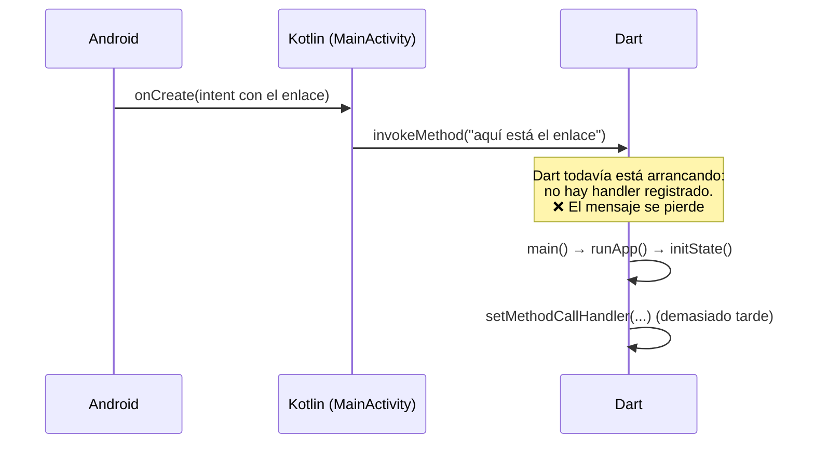
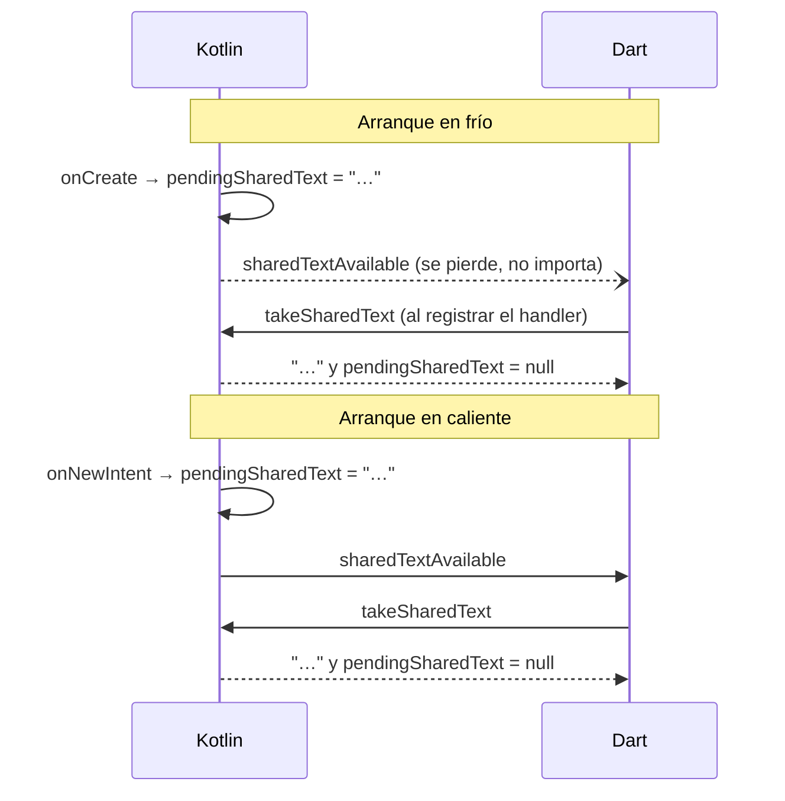

# Guía: recibir contenido desde el menú "Compartir" de Android

> **Objetivo:** que tu app aparezca en el menú **Compartir** de otras apps y reciba lo que el usuario comparte (texto, enlaces, imágenes, archivos).
>
> **Caso real de este proyecto:** en TikTok → *Compartir* → **PlayTT**, la app se abre en la pestaña Descargar con el video ya procesado.
>
> **Requisitos para seguirla:** saber qué es una `Activity` y haber usado un `MethodChannel` de Flutter (si no, ver [native-bridge.md](../native-bridge.md)).

## Índice

1. [Conceptos de Android que necesitas](#1-conceptos-de-android-que-necesitas)
2. [El problema de sincronización con Flutter](#2-el-problema-de-sincronización-con-flutter)
3. [Implementación paso a paso](#3-implementación-paso-a-paso)
4. [Casos borde](#4-casos-borde)
5. [Cómo probarlo](#5-cómo-probarlo)
6. [Replicarlo en otros proyectos](#6-replicarlo-en-otros-proyectos)
7. [Errores comunes](#7-errores-comunes)
8. [Referencias](#8-referencias)

---

## 1. Conceptos de Android que necesitas

### 1.1 Intents: mensajes entre apps

Un **Intent** es un mensaje que pide "haz esto". Hay dos tipos:

| Tipo | Qué dice | Ejemplo |
|---|---|---|
| **Explícito** | *Quién* debe hacerlo | "Abre `MainActivity` de mi app" |
| **Implícito** | *Qué* hay que hacer, sin decir quién | "Que alguien **envíe** este texto" |

Cuando tocas *Compartir* en TikTok, TikTok crea un intent **implícito**:

```kotlin
// Esto lo hace TikTok, no nosotros:
val intent = Intent(Intent.ACTION_SEND).apply {
    type = "text/plain"                                   // tipo MIME del contenido
    putExtra(Intent.EXTRA_TEXT, "Mira este video… https://vm.tiktok.com/xxx/")
}
startActivity(Intent.createChooser(intent, null))         // abre el menú Compartir
```

Partes clave:
- **Acción** (`ACTION_SEND`): qué se quiere hacer.
- **Tipo MIME** (`text/plain`, `image/*`, …): qué clase de contenido viaja.
- **Extras** (`EXTRA_TEXT`, `EXTRA_STREAM`, …): el contenido en sí.

### 1.2 Intent filters: cómo una app dice "yo puedo hacer eso"

Android arma el menú Compartir buscando todas las actividades que declararon un **intent filter** compatible en su `AndroidManifest.xml`:

```xml
<intent-filter>
    <action android:name="android.intent.action.SEND"/>       <!-- acepto "enviar" -->
    <category android:name="android.intent.category.DEFAULT"/> <!-- obligatoria para intents implícitos -->
    <data android:mimeType="text/plain"/>                      <!-- solo texto -->
</intent-filter>
```

> **¿Por qué `DEFAULT`?** `startActivity()` agrega la categoría `DEFAULT` a todo intent implícito. Si tu filtro no la declara, nunca coincide y tu app no aparece en el menú. Es el error más común.

Para que una actividad pueda ser abierta por **otras** apps, además necesita `android:exported="true"`, que es obligatorio declarar explícitamente desde Android 12.

### 1.3 Tareas y `launchMode`

Una **tarea** (*task*) es la pila de pantallas que ves en *Recientes*. Por defecto, cuando TikTok abre tu actividad, Android la crea **dentro de la tarea de TikTok**:

```
Sin singleTask                         Con singleTask
──────────────                         ──────────────
Tarea TikTok      Tarea Reproductor    Tarea TikTok     Tarea Reproductor
┌───────────────┐ ┌──────────────┐     ┌────────────┐   ┌──────────────┐
│ MainActivity ◄┼─┼─ ¡2ª copia!  │     │ TikTok     │   │ MainActivity │◄─ onNewIntent()
│ TikTok        │ │ MainActivity │     └────────────┘   └──────────────┘
└───────────────┘ └──────────────┘
```

Tener dos copias de la actividad es problemático en cualquier app. **En esta lo es doblemente:** `audio_service` mantiene **un único motor de Flutter** en caché, y dos actividades pelearían por él.

El atributo `launchMode` controla este comportamiento:

| `launchMode` | Si la actividad ya existe… |
|---|---|
| `standard` (por defecto) | Crea otra copia siempre |
| `singleTop` | Reutiliza solo si está **arriba de la misma tarea**: no sirve para intents que vienen de otra app |
| **`singleTask`** | **Reutiliza la existente**, la trae a primer plano en su propia tarea y le entrega el intent con `onNewIntent()` |
| `singleInstance` | Como `singleTask`, pero ninguna otra actividad puede vivir en su tarea |

Por eso este proyecto cambió de `singleTop` a **`singleTask`**.

### 1.4 Arranque en frío y en caliente

El intent llega por un método distinto según el estado de la app:

| Situación | Método que recibe el intent |
|---|---|
| **En frío:** la app estaba cerrada | `onCreate(savedInstanceState)` → `getIntent()` |
| **En caliente:** la app ya estaba abierta | `onNewIntent(intent)` |

Hay que manejar **los dos**. Olvidar `onNewIntent` es el segundo error más común: la primera vez funciona y, a partir de ahí, compartir solo trae la app al frente sin hacer nada.

---

## 2. El problema de sincronización con Flutter

En una app nativa, el intent se procesa en `onCreate` y listo. En Flutter hay un problema: **Kotlin recibe el intent antes de que Dart esté listo para escuchar.**



### Solución: guardar en Kotlin, avisar y que Dart lo pida

Combinamos dos mecanismos, cada uno cubre el hueco del otro:

1. **Kotlin guarda** el texto en una variable (`pendingSharedText`).
2. **Push (avisar):** Kotlin le dice a Dart "hay algo nuevo" (`sharedTextAvailable`). Si Dart no está escuchando, el aviso se pierde, pero el texto sigue guardado.
3. **Pull (pedir):** Dart, al arrancar y cada vez que recibe un aviso, pide el texto (`takeSharedText`). Kotlin lo entrega **y lo borra**, para que no se procese dos veces.



Este patrón (**estado guardado + aviso + lectura que consume**) sirve para cualquier evento nativo que pueda llegar antes que Dart: notificaciones tocadas, deep links, resultados de otras actividades, etc.

> **¿Por qué no mandar el texto en el aviso?** Porque entonces habría dos caminos de entrega con el mismo dato y habría que evitar procesarlo dos veces. Con "avisar sin datos + pedir", **solo existe un camino de entrega** (`takeSharedText`) y la deduplicación es trivial: quien lee, borra.

---

## 3. Implementación paso a paso

### Paso 1: declarar el filtro y el `launchMode`

`android/app/src/main/AndroidManifest.xml`:

```xml
<activity
    android:name=".MainActivity"
    android:exported="true"
    android:launchMode="singleTask"
    ...>

    <!-- El de siempre: ícono en el lanzador -->
    <intent-filter>
        <action android:name="android.intent.action.MAIN"/>
        <category android:name="android.intent.category.LAUNCHER"/>
    </intent-filter>

    <!-- Nuevo: aparecer en "Compartir" al compartir texto -->
    <intent-filter android:label="Extraer audio">
        <action android:name="android.intent.action.SEND"/>
        <category android:name="android.intent.category.DEFAULT"/>
        <data android:mimeType="text/plain"/>
    </intent-filter>
</activity>
```

`android:label` en el filtro define el texto que se ve en el menú Compartir. Algunos fabricantes lo ignoran y muestran el nombre de la app.

### Paso 2: recibir el intent en Kotlin

`MainActivity.kt` (resumido):

```kotlin
class MainActivity : AudioServiceActivity() {
    private companion object {
        var pendingSharedText: String? = null   // estático: sobrevive si la actividad se recrea
        var channel: MethodChannel? = null
    }

    override fun onCreate(savedInstanceState: Bundle?) {
        super.onCreate(savedInstanceState)
        // En frío. Si se está recreando (rotación, cambio de idioma…), el intent
        // es el mismo de antes: no hay que procesarlo otra vez.
        if (savedInstanceState == null) handleShareIntent(intent)
    }

    override fun onNewIntent(intent: Intent) {
        super.onNewIntent(intent)   // ¡no olvidar! Flutter y los plugins también lo usan
        handleShareIntent(intent)   // en caliente
    }

    private fun handleShareIntent(intent: Intent?) {
        if (intent?.action != Intent.ACTION_SEND) return
        if (intent.type?.startsWith("text/") != true) return
        // Abrir desde Recientes repite el último intent: no es un envío nuevo.
        if (intent.flags and Intent.FLAG_ACTIVITY_LAUNCHED_FROM_HISTORY != 0) return

        pendingSharedText = intent.getStringExtra(Intent.EXTRA_TEXT) ?: return
        channel?.invokeMethod("sharedTextAvailable", null)    // push
    }

    override fun configureFlutterEngine(flutterEngine: FlutterEngine) {
        super.configureFlutterEngine(flutterEngine)
        val methodChannel = MethodChannel(flutterEngine.dartExecutor.binaryMessenger, "prueba_reproductor/media")
        channel = methodChannel
        methodChannel.setMethodCallHandler { call, result ->
            when (call.method) {
                "takeSharedText" -> {                         // pull
                    result.success(pendingSharedText)
                    pendingSharedText = null                  // se entrega una sola vez
                }
                // … otros métodos
            }
        }
    }
}
```

> **Orden de ejecución en frío:** `super.onCreate()` adjunta el motor de Flutter y llama a `configureFlutterEngine()`. Por eso, cuando corre `handleShareIntent`, `channel` ya existe.

### Paso 3: escuchar en Dart

`lib/native_bridge.dart`:

```dart
static Future<void> listenSharedText(void Function(String text) onText) async {
  Future<void> take() async {
    final text = await _channel.invokeMethod<String>('takeSharedText');
    if (text != null && text.trim().isNotEmpty) onText(text);
  }

  _channel.setMethodCallHandler((call) async {
    if (call.method == 'sharedTextAvailable') await take();   // en caliente
  });
  await take();                                               // en frío
}
```

> ⚠️ **Un canal admite un solo handler en Dart.** Si otra parte del código llamara a `setMethodCallHandler` en el mismo canal, reemplazaría a este. Si en el futuro Kotlin necesita llamar a Dart por otros motivos, centraliza el `switch` en `NativeBridge` o usa un canal separado para eventos.

### Paso 4: usar el contenido en la interfaz

El texto compartido trae más cosas que el enlace:

```
Mira el video de MONKY FORCE en TikTok! #fyp https://vt.tiktok.com/ZSgju8QE6/
```

`lib/tiktok_service.dart` extrae el enlace con una expresión regular:

```dart
String? extractTikTokUrl(String text) =>
    RegExp(r'https?://[^\s]*tiktok\.com[^\s]*', caseSensitive: false)
        .firstMatch(text)
        ?.group(0);
```

`lib/home_shell.dart` decide qué hacer con él:

```dart
void _onSharedText(String text) {
  final url = extractTikTokUrl(text);
  if (url == null) { /* diálogo "Enlace no válido" */ return; }
  Navigator.of(context).popUntil((route) => route.isFirst); // cierra el reproductor si está abierto
  setState(() => _tab = _downloaderTab);                    // pestaña Descargar
  _sharedLink.value = url;                                  // la pantalla lo procesa
}
```

La comunicación con la pestaña se hace con un `ValueNotifier<String?>`. `DownloaderScreen` lo escucha, pone el enlace en el campo, llama a `_processLink()` y lo vuelve a dejar en `null`. Así la pantalla no necesita una `GlobalKey` ni exponer su estado.

---

## 4. Casos borde

| Caso | Qué pasaría sin cuidado | Cómo se resuelve |
|---|---|---|
| Compartir con la app cerrada | El texto llega antes que Dart y se pierde | Pull al arrancar (`takeSharedText`) |
| Compartir con la app abierta | Se crea una segunda actividad | `launchMode="singleTask"` + `onNewIntent` |
| Abrir la app desde *Recientes* | Android repite el último intent → se procesaría otra vez el enlace viejo | Ignorar `FLAG_ACTIVITY_LAUNCHED_FROM_HISTORY` |
| Rotar la pantalla o cambiar el tema | `onCreate` se ejecuta de nuevo con el mismo intent | Procesar solo si `savedInstanceState == null` |
| Hot restart durante el desarrollo | Dart vuelve a pedir el texto | `takeSharedText` lo borra al entregarlo |
| Compartir mientras se descarga otro | Se pisaría el estado de la pantalla | Se muestra "Espera a que termine el proceso actual" |
| Texto sin enlace de TikTok (p. ej. desde YouTube) | Error confuso de la API | Diálogo "Enlace no válido" antes de llamar a la API |
| El reproductor completo está abierto | El usuario no ve la pestaña Descargar | `popUntil(route.isFirst)` |

**Costo de `singleTask`:** al traer la actividad al frente, Android cierra las actividades que estuvieran **encima** de ella en su tarea. Si el usuario dejó abierto el selector de carpetas del sistema y comparte desde TikTok, el selector se cierra. Es aceptable aquí, y la app ya maneja un selector que se cierra sin responder.

---

## 5. Cómo probarlo

### Manual
1. Compilación completa (cambiaste el manifest y Kotlin): ⏹ y luego **F5**.
2. **En frío:** fuerza la detención de la app → TikTok → Compartir → *Reproductor*.
3. **En caliente:** con la app abierta (incluso reproduciendo música), repite desde TikTok.
4. **Recientes:** después de compartir, cierra la app con atrás y ábrela desde *Recientes*: **no** debe procesar el enlace otra vez.
5. **Texto inválido:** comparte un enlace de YouTube → diálogo "Enlace no válido".

En la consola, filtra por `share:` para ver `share: texto recibido (N caracteres)`.

### Con `adb` (sin usar TikTok)
`adb` viene con el SDK de Android (`platform-tools`). Simula exactamente lo que hace TikTok:

```bash
# Arranque en frío
adb shell am force-stop com.playtt.app
adb shell am start -a android.intent.action.SEND -t text/plain \
  --es android.intent.extra.TEXT "'Mira esto https://vt.tiktok.com/ZSgju8QE6/'" \
  -n com.playtt.app/.MainActivity

# Arranque en caliente: el mismo comando con la app ya abierta
```

Para ver en qué apps puede aparecer tu actividad, o depurar por qué no aparece:

```bash
adb shell dumpsys package com.playtt.app | grep -A5 "android.intent.action.SEND"
```

---

## 6. Replicarlo en otros proyectos

### 6.1 Checklist mínimo

- [ ] `intent-filter` con `ACTION_SEND` + categoría `DEFAULT` + `mimeType`.
- [ ] `android:exported="true"` en la actividad.
- [ ] `launchMode="singleTask"` (o una actividad intermedia, ver 6.4).
- [ ] Manejar el intent en `onCreate` **y** en `onNewIntent`.
- [ ] Ignorar `FLAG_ACTIVITY_LAUNCHED_FROM_HISTORY` y las recreaciones (`savedInstanceState != null`).
- [ ] Guardar el contenido hasta que Dart lo pida (patrón de la [sección 2](#2-el-problema-de-sincronización-con-flutter)).
- [ ] Validar el contenido antes de usarlo: nunca confíes en lo que manda otra app.
- [ ] Probar en frío, en caliente y desde Recientes.

### 6.2 Recibir imágenes o archivos

Cambian el filtro y la forma de leer el contenido:

```xml
<intent-filter>
    <action android:name="android.intent.action.SEND"/>
    <category android:name="android.intent.category.DEFAULT"/>
    <data android:mimeType="image/*"/>          <!-- o "audio/*", "application/pdf", "*/*" -->
</intent-filter>
```

El archivo **no** viene como texto sino como una URI `content://` en `EXTRA_STREAM`:

```kotlin
val uri: Uri? = if (Build.VERSION.SDK_INT >= 33) {
    intent.getParcelableExtra(Intent.EXTRA_STREAM, Uri::class.java)
} else {
    @Suppress("DEPRECATION") intent.getParcelableExtra(Intent.EXTRA_STREAM)
}
```

> ⚠️ **El permiso para leer esa URI es temporal:** dura mientras viva la actividad que recibió el intent. Si vas a usar el archivo después, **cópialo de inmediato** a la caché de tu app:
> ```kotlin
> val copy = File(cacheDir, "compartido_${System.currentTimeMillis()}")
> contentResolver.openInputStream(uri)!!.use { input -> copy.outputStream().use { input.copyTo(it) } }
> // Envía copy.path a Dart, no la URI.
> ```

### 6.3 Recibir varios elementos

Usa `ACTION_SEND_MULTIPLE` en el filtro y lee una lista:

```kotlin
val uris = if (Build.VERSION.SDK_INT >= 33) {
    intent.getParcelableArrayListExtra(Intent.EXTRA_STREAM, Uri::class.java)
} else {
    @Suppress("DEPRECATION") intent.getParcelableArrayListExtra<Uri>(Intent.EXTRA_STREAM)
}
```

### 6.4 Alternativa a `singleTask`: actividad intermedia

Si tu actividad principal no puede ser `singleTask` (por ejemplo, porque abre otras actividades encima que no deben cerrarse), declara el filtro en una actividad **invisible** que solo recibe el intent, lo reenvía a la principal y se cierra:

```kotlin
class ShareReceiverActivity : Activity() {
    override fun onCreate(savedInstanceState: Bundle?) {
        super.onCreate(savedInstanceState)
        startActivity(Intent(this, MainActivity::class.java).apply {
            action = Intent.ACTION_SEND
            type = intent.type
            putExtras(intent)
            addFlags(Intent.FLAG_ACTIVITY_NEW_TASK or Intent.FLAG_ACTIVITY_CLEAR_TOP or Intent.FLAG_ACTIVITY_SINGLE_TOP)
        })
        finish()
    }
}
```

Con tema `@android:style/Theme.Translucent.NoTitleBar` y `excludeFromRecents="true"`. Es más flexible, pero agrega una pieza más y hay que cuidar el `taskAffinity`.

### 6.5 Usar un paquete en vez de código propio

[`receive_sharing_intent`](https://pub.dev/packages/receive_sharing_intent) implementa todo esto en Android **e iOS**:

| | Código propio (este proyecto) | `receive_sharing_intent` |
|---|---|---|
| Líneas de código | ~40 | ~10 |
| iOS | No | Sí (requiere crear una *Share Extension* en Xcode) |
| Control de casos borde | Total | El que tenga el paquete |
| Dependencias nativas nuevas | 0 | 1 |
| Aprendizaje | Alto | Bajo |

**Regla práctica:** si necesitas iOS o tipos de contenido variados, usa el paquete. Si es solo Android y solo texto, el código propio es pequeño y no agrega dependencias. Este proyecto lo eligió así por eso y para entender el mecanismo ([ADR-0006](../adr/0006-recibir-enlaces-compartidos.md)).

### 6.6 ¿Y en iOS?

iOS no tiene intents. Para aparecer en su hoja de compartir hace falta una **Share Extension**: un *target* aparte en Xcode, con su propio código Swift, que se comunica con la app mediante un *App Group* (almacenamiento compartido) y una URL personalizada para abrirla. Es bastante más trabajo que en Android, y es el motivo principal para usar un paquete si necesitas ambas plataformas.

### 6.7 ¿Y en React Native?

El mecanismo de Android es **idéntico** (manifest, `onCreate`, `onNewIntent`) y existe el mismo problema de sincronización con JavaScript. Los paquetes de la comunidad (p. ej. `expo-share-intent`) aplican el mismo patrón de guardar el valor y entregarlo cuando JavaScript lo pide.

---

## 7. Errores comunes

| Síntoma | Causa probable |
|---|---|
| La app no aparece en el menú Compartir | Falta la categoría `DEFAULT`, el `mimeType` no coincide, falta `exported="true"`, o no se hizo una compilación completa |
| Funciona solo la primera vez | Falta `onNewIntent`, o `launchMode` no es `singleTask` |
| Se abre una segunda copia de la app sobre la que comparte | `launchMode` es `standard` o `singleTop` |
| El enlace se procesa otra vez al abrir desde Recientes | No se filtra `FLAG_ACTIVITY_LAUNCHED_FROM_HISTORY` |
| Con la app cerrada no hace nada; abierta sí | El texto se envió a Dart antes de que escuchara y no se guardó (falta el *pull*) |
| `MissingPluginException: takeSharedText` | APK viejo: falta una compilación completa |
| `SecurityException` al leer una imagen compartida más tarde | El permiso de la URI expiró: hay que copiar el archivo al recibirlo |

---

## 8. Referencias

- Android Developers: [Recibir datos simples de otras apps](https://developer.android.com/training/sharing/receive)
- Android Developers: [Intents y filtros de intents](https://developer.android.com/guide/components/intents-filters)
- Android Developers: [Tareas y la pila de actividades](https://developer.android.com/guide/components/activities/tasks-and-back-stack)
- Flutter: [Escribir código específico de plataforma (platform channels)](https://docs.flutter.dev/platform-integration/platform-channels)
- En este repositorio: [native-bridge.md](../native-bridge.md), [ADR-0006](../adr/0006-recibir-enlaces-compartidos.md)
